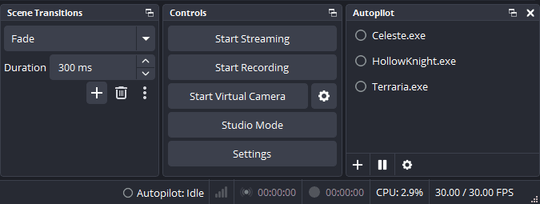
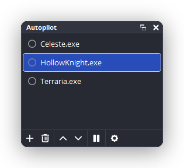
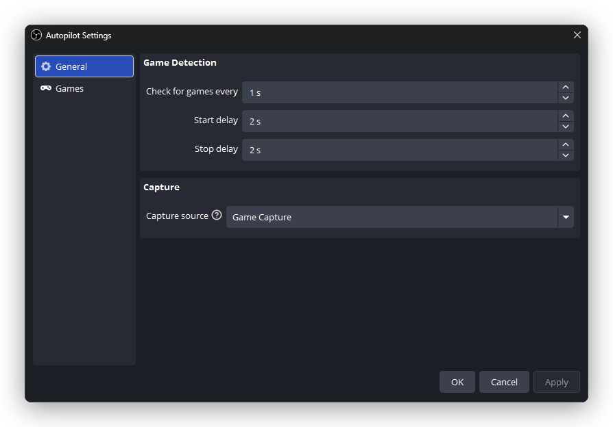
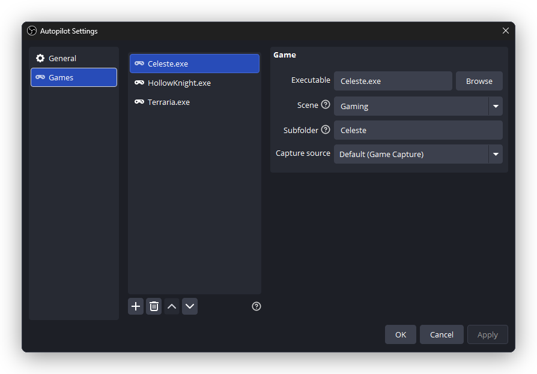

# obs-autopilot

_Formerly AutoRecordOBS_

Autopilot is an OBS Studio plugin that automatically starts recording when one of your games launches and stops when it closes, while also allowing per-game output directories!

[](https://github.com/NotNecrotic/obs-autopilot/releases/latest)

## How it works

Launch a configured game and Autopilot takes it from there! It switches to the game's scene, points your capture source at the game and starts recording into the game's folder. Close the game and it stops recording and switches back.

<p align="center">
  
</p>

## Features

- **Automatic game detection**: starts recording when a configured game is running and stops when it closes.
- **Per-game output folders**: give a game a subfolder name, and its recordings are saved in `<your OBS recording path>\<subfolder>`.
- **Points your capture at the game**: when recording starts, a Game Capture or Window Capture source you choose is set to the game's window, so one capture source works for every game. Games can use their own source instead.
- **Per-game scene switching**: switches to a chosen scene just before recording starts, and back to your previous scene once the game closes (unless you picked a different scene yourself in the meantime).
- **Start/stop delays**: so loading screens and quick restarts don't cause extra recordings.
- **Status bar indicator**: an "Autopilot: …" item next to OBS's REC timer shows what's happening (idle, countdown, which game is recording, paused). Click it to pause automation, open settings or show the dock. Hover it to see where the recording is being saved.
- **Games dock**: lists your games with a dot for each one's state: grey when closed, green when running, amber while counting down, red while recording. Add games with **+**, drag them to reorder, or select one to remove it or move it up and down, without opening settings. Styled like OBS's Scenes dock and follows your theme.

## Requirements

- Windows 10/11 x64
- OBS Studio 31.1 or newer

## Installation

1. Close OBS.
2. Download `autopilot-<version>-windows-x64-Installer.exe` from [Releases](https://github.com/NotNecrotic/obs-autopilot/releases/latest) and run it.
   - Manual install: extract the `.zip` into `C:\ProgramData\obs-studio\plugins\`, so that you end up with `C:\ProgramData\obs-studio\plugins\autopilot\bin\64bit\autopilot.dll`.
3. Start OBS. The "Autopilot: Idle" indicator appears in the status bar; open **Docks → Autopilot** for the games dock.

## Usage

### The dock



Open it from **Docks → Autopilot**. Each game's dot shows what it's doing; hover a game for details.

- **+** adds a game (**Browse for Game…** or **Add Running Program…**).
- Drag a game up or down to change its priority, like reordering scenes.
- Select a game to remove it (trash) or move it with the arrows. Click anywhere else to deselect.
- **Pause** stops Autopilot from starting new recordings; a recording already running carries on.
- The **gear** opens the settings.

<br clear="right">

### Settings

Open **Tools → Autopilot Settings**, click the status bar indicator, or use the gear on the dock.

**General**

<p align="center">
  
</p>

| Setting               | Default | Description                                                                                                                         |
| --------------------- | ------- | ----------------------------------------------------------------------------------------------------------------------------------- |
| Check for games every | 5 s     | How often running programs are checked.                                                                                             |
| Start delay           | 0 s     | How long a game must be running before recording starts.                                                                            |
| Stop delay            | 0 s     | How long to keep recording after a game closes.                                                                                     |
| Capture source        | None    | A Game Capture or Window Capture source to point at each game's window when its recording starts. _None_ leaves your sources alone. |

**Games**

<p align="center">
  
</p>

Add games with the **+** button (**Browse for Game…** to pick the `.exe` from disk, or **Add Running Program…** to choose from what's running now). Select a game to edit it:

| Setting        | Description                                                                                                                                                             |
| -------------- | ----------------------------------------------------------------------------------------------------------------------------------------------------------------------- |
| Executable     | The game's `.exe` name, e.g. `VRChat.exe`.                                                                                                                              |
| Scene          | Scene to switch to before recording. Leave it empty to stay on the current scene.                                                                                       |
| Subfolder      | Optional. Folder name inside your OBS recording path for this game's recordings, e.g. `VRChat` or `VRChat/Clips`. Hover the **?** to see the full path it will save to. |
| Capture source | _Default_ uses the source chosen on the General page; pick another source for games that need their own.                                                                |

The capture source is matched by the game's `.exe`, so it keeps working when the game changes its window title, and it works even if the game's window opens after recording starts.

If several configured games are running, the highest one in the list is recorded; use the arrow buttons (or drag games in the dock) to reorder.

The subfolder is relative to the recording path set in **Settings → Output** (Simple or Advanced mode, including Advanced mode's _Custom Output (FFmpeg)_ when it writes to a file). Autopilot changes the path only while the recording starts and then puts it back, so your OBS settings are never permanently changed.

### Where settings are stored

`%APPDATA%\obs-studio\plugin_config\autopilot\config.json`

## Development

Prerequisites: Visual Studio 2022 with the _Desktop development with C++_ workload, CMake 3.28+, and the Windows 10/11 SDK.

```powershell
git clone https://github.com/NotNecrotic/obs-autopilot.git
cd obs-autopilot
cmake --preset windows-x64
cmake --build --preset windows-x64
```

The first configure downloads the OBS Studio sources, the prebuilt obs-deps and Qt6 (versions are pinned in `buildspec.json`) into `.deps/`. The plugin is built at `build_x64/RelWithDebInfo/autopilot.dll`, and `build_x64/rundir/` holds a ready-to-copy plugin layout.

The `windows-x64` preset targets Windows SDK 10.0.22621. If you have a different SDK, add a `CMakeUserPresets.json` (gitignored) that inherits `windows-x64` and sets `"architecture": "x64,version=<your SDK version>"`.

To build the installer:

```powershell
cmake --install build_x64 --prefix release/RelWithDebInfo --config RelWithDebInfo
& "${env:ProgramFiles(x86)}\Inno Setup 6\ISCC.exe" installer\autopilot.iss
```

The screenshots in this README were captured from OBS Studio 32.2 with the Yami theme, using a demo scene collection.

Pushing a `v*` tag (e.g. `v3.0.0`) builds a Release configuration and drafts a GitHub release with the zip and the installer.

The project is based on [obs-plugintemplate](https://github.com/obsproject/obs-plugintemplate).

## License

Autopilot is free software, licensed under the [GNU General Public License v2.0](LICENSE) or (at your option) any later version, the same license as OBS Studio. Versions up to 2.1.1 (AutoRecordOBS) were released under the MIT License.

<br>
<br>
<p align="center">
  
  
  
  
  
</p>
